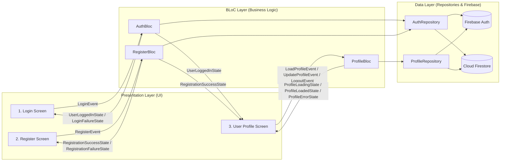

# Flutter Login, Register & User Profile System (BLoC Architecture)

A complete Flutter Authentication & User Profile application built with **BLoC Architecture (`flutter_bloc`)**, **Repository Pattern**, **Firebase Authentication**, and **Cloud Firestore**.

---

## Architecture Overview



---

## Folder Structure

```text
lib/
├── main.dart
├── firebase_options.dart
├── core/
│   ├── constants/
│   │   └── app_constants.dart
│   ├── theme/
│   │   └── app_theme.dart
│   └── utils/
│       └── validators.dart
├── data/
│   ├── models/
│   │   └── user_model.dart
│   └── repositories/
│       ├── auth_repository.dart
│       └── profile_repository.dart
└── presentation/
    ├── blocs/
    │   ├── auth/
    │   │   ├── auth_bloc.dart
    │   │   ├── auth_event.dart
    │   │   └── auth_state.dart
    │   ├── register/
    │   │   ├── register_bloc.dart
    │   │   ├── register_event.dart
    │   │   └── register_state.dart
    │   └── profile/
    │       ├── profile_bloc.dart
    │       ├── profile_event.dart
    │       └── profile_state.dart
    ├── screens/
    │   ├── login_screen.dart
    │   ├── register_screen.dart
    │   └── profile_screen.dart
    └── widgets/
        ├── app_logo_header.dart
        ├── custom_button.dart
        └── custom_text_field.dart
```

---

## Setup & Installation Steps

### 1. Install Dependencies
```bash
flutter pub get
```

### 2. Configure Firebase
1. Create a project in the [Firebase Console](https://console.firebase.google.com/).
2. Enable **Authentication** -> **Sign-in method** -> **Email/Password**.
3. Enable **Cloud Firestore** database and set up security rules:
   ```javascript
   rules_version = '2';
   service cloud.firestore {
     match /databases/{database}/documents {
       match /users/{userId} {
         allow read, write: if request.auth != null && request.auth.uid == userId;
       }
     }
   }
   ```
4. Connect your Flutter project using FlutterFire CLI:
   ```bash
   dart pub global activate flutterfire_cli
   flutterfire configure
   ```
   *(This automatically updates `lib/firebase_options.dart` with your Firebase API keys.)*

### 3. Run the Application
```bash
flutter run
```

### 4. Run BLoC Unit Tests
```bash
flutter test
```
